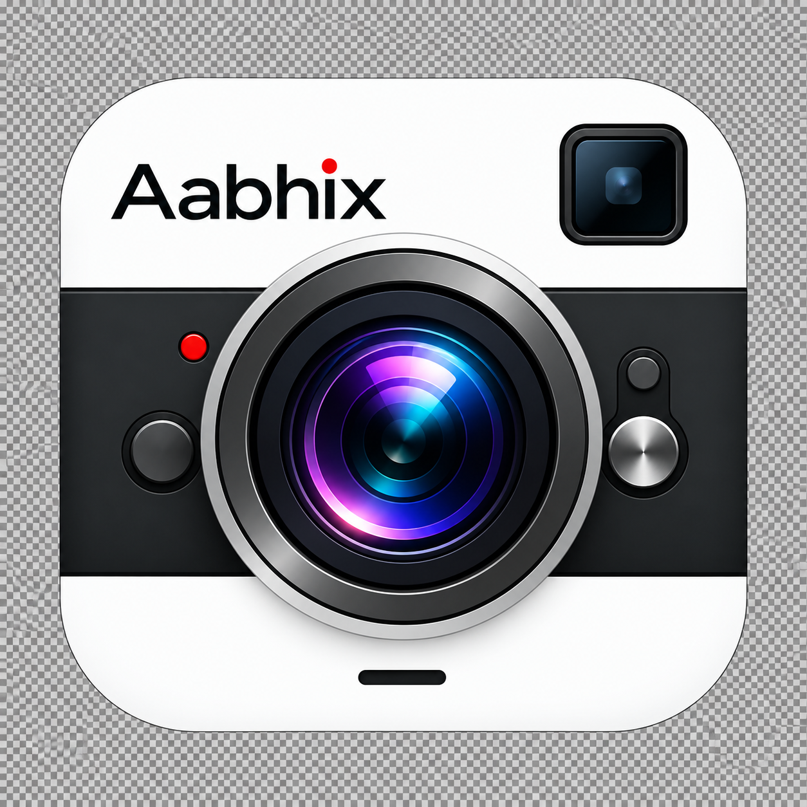

# AABHIX CAME



An offline Android camera application built with Java, Camera2, OpenGL ES, MediaRecorder and scoped MediaStore. This repository contains the complete application and test source for the **0.11.0 development milestone**.

**Status:** active development. Standard capture, manual controls, grading, imports and several repair flows are implemented. This is not a finished replacement for every stock, Blackmagic, GCam or LMC feature.

## Project at a glance

| Item | Value |
|---|---|
| Application | Aabhix |
| Package | `com.aabhix.camera` |
| Current version | `0.11.0` / version code `11` |
| Minimum Android | Android 10 / API 29 |
| Compile / target SDK | 36 / 35 |
| Language / JDK | Java 17 |
| Build tools | Gradle 8.13, Android Gradle Plugin 8.11.1 |
| Runtime dependencies | Android framework only |
| Test dependency | JUnit 4.13.2 |
| Device used for local testing | Vivo T2 Pro, Android identifier V2321, Android 15 |

## Implemented features

- Photo, Video and inline Pro controls; searchable full-page camera settings.
- Hardware-bounded manual ISO, shutter, exposure compensation, autofocus/manual focus, zoom, white-balance presets and supported locks.
- Capability-gated AVC/SDR video format and FPS selection, portrait/landscape framing, recording finalization and private recovery files.
- 36 original built-in styles including Original; affine color grading and bounded 3D LUT import using CUBE, explicit tiled PNG and native JSON formats.
- Local style library with favorites, recent styles and collections; intensity control and unfiltered preview comparison.
- Photo/video film mattes and borders, grid controls, sampled RGB histogram, battery/storage readouts.
- Unicode text watermarks with independent photo/video enablement, position, size and opacity; scope switches update immediately.
- XML profile library with mapped-key review, current-setup saving and a last-applied receipt. Private GCam/LMC processing keys are retained rather than falsely executed.
- Scoped gallery export, original-photo preservation, JPEG metadata minimization, optional microphone recording and no network/location permission.

### Latest repairs

0.11 adds a searchable configuration library, batch XML import (up to 100 files), four native starter profiles, and saved look/intensity/original-copy settings. Photo JPEGs stream directly into pending gallery rows; the LUT sampler computes each interpolation corner once. See [0.11 validation](docs/VALIDATION-0.11.md).

0.10 aligns GPU video presentation timestamps with the recorder's monotonic timeline, filters nonterminal/stale recorder callbacks, prevents conflicting mode changes during camera reconfiguration, bounds thumbnail readback, and corrects watermark OFF/sample behavior.

See [architecture](docs/ARCHITECTURE.md), [feature status and roadmap](docs/FEATURES.md), [validation](docs/VALIDATION.md) and [XML profiles](docs/CONFIGURATION.md).

## Build from source

Install **JDK 17**, Android SDK Platform 36, Build Tools 36.0.0 and platform-tools. Set `JAVA_HOME` and `ANDROID_HOME`, or configure your SDK in an untracked `local.properties` file (`sdk.dir=...`). Android Studio can open the repository root directly.

```bash
git clone https://github.com/0xSnipFi/AABHIX-CAME.git
cd AABHIX-CAME
bash ./gradlew --no-daemon :app:testDebugUnitTest :app:lintDebug :app:assembleDebug :app:assembleDebugAndroidTest
```

Windows PowerShell:

```powershell
.\build.ps1
# Or:
.\gradlew.bat --no-daemon :app:testDebugUnitTest :app:lintDebug :app:assembleDebug :app:assembleDebugAndroidTest
```

Output APKs:

- `app/build/outputs/apk/debug/app-debug.apk`
- `app/build/outputs/apk/androidTest/debug/app-debug-androidTest.apk`

The first build downloads the wrapper, Android plugins and JUnit. No private signing key or machine-specific SDK path is required: the standard Android debug signing configuration creates a local development key. This key differs from the owner's existing development build; an APK signed with a different key cannot update that installation. Keep signing keys private and manage a release key separately.

## Run on a phone

Enable USB debugging, authorize ADB, then:

```bash
adb install -r app/build/outputs/apk/debug/app-debug.apk
adb shell am start -n com.aabhix.camera/.MainActivity
```

Camera permission is required. Microphone permission is optional and requested when enabled. Resolution/FPS/manual controls depend on the active camera and encoder. Check actual saved media rather than assuming that a reported hardware capability guarantees a working combination.

## Tests

```bash
# Host-side tests and lint
bash ./gradlew :app:testDebugUnitTest :app:lintDebug

# Explicit device test: creates photos/videos on the connected phone
adb install -r app/build/outputs/apk/androidTest/debug/app-debug-androidTest.apk
adb shell am instrument -w -e mode core com.aabhix.camera.test/com.aabhix.camera.validation.CameraValidation
```

Keep the phone unlocked and Aabhix foreground during device tests. Other useful modes: `gpu`, `orientation`, `processing08`, `watermark08`, `photo09`, `reliability10`, `ui07`. Some historical modes require separately supplied local test configurations/LUTs. `photo09` intentionally enables Photo watermark; `reliability10` intentionally leaves both watermark scopes OFF. The test APK also contains explicit developer scope-restoration helpers. Review each mode before running it on a personal installation. Do not run unspecified/default instrumentation as if it were a read-only check: it captures media.

Tests write a private JSON report at `files/preset-validation.json`:

```bash
adb shell run-as com.aabhix.camera cat files/preset-validation.json
```

Check `finished`, `fatal` and individual results; a completed shell command alone does not prove success. The GitHub workflow runs host tests/lint/build and uploads debug artifacts. It does not run physical-device tests.

## Important limitations

Night fusion, portrait segmentation/depth blur, HDR fusion, RAW/DNG, panorama stitching, time-lapse, slow motion, QR decoding, HEVC/Log/10-bit, advanced audio routing, zebra/peaking/false color/waveform and remote/cloud integrations are not complete. See the [roadmap](docs/FEATURES.md).

GCam/LMC XML compatibility is a limited adapter, not an imported GCam processing engine. Color presets do not supply computational Night or Portrait capture. Watermarks and film frames are baked into exported media when enabled; disabling them affects future captures, not already-exported pixels. Camera backgrounding finalizes recording; background capture service is not implemented.

The tested 720p microphone clips and short hardware tests do not establish universal compatibility, calibrated color accuracy, long-run thermal stability, lip-sync accuracy or sustained 4K30. A prior 4K sample averaged approximately 24.31 FPS despite a 30 FPS request.

## Privacy and source provenance

The app has no INTERNET, location or broad storage permission. Photos/videos remain on the device unless the user shares them. Captures, private profiles/LUTs, phone identifiers, user watermarks, research screenshots, signing keys, local SDK files and raw device logs are not included in this public repository.

Runtime code is original Java using public Android APIs. The included app icon is an owner-supplied project asset. No additional open-source license has been selected for this repository; public source visibility alone is not an additional license grant. See [third-party notices](THIRD_PARTY_NOTICES.md).

## Contributing

See [CONTRIBUTING.md](CONTRIBUTING.md). Report the device/Android version, reproduction steps, active mode/format, expected behavior and actual result. Redact personal media, credentials and identifying metadata from issue attachments.
